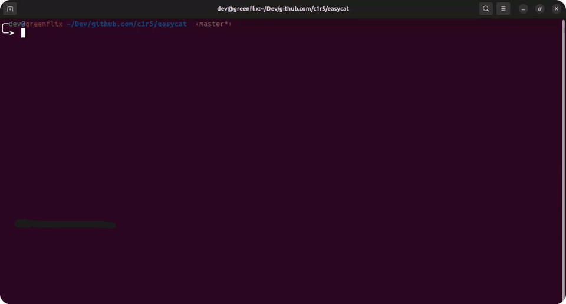

# easycat

`easycat` is a fast terminal UI for Android `logcat` debugging through ADB.

It helps you:

- list connected Android devices
- list installed packages for the selected device
- stream `logcat` in real time
- filter apps by typing in the Apps panel
- filter logs by text, level, and selected app PID
- navigate filters from the keyboard
- read wrapped log lines inside the terminal viewport
- pause, clear, scroll, and follow logs without leaving the terminal

## Installation

### Requirements

- Go 1.25 or newer
- ADB available in your `PATH`
- An Android device or emulator with USB debugging enabled

Check ADB:

```sh
adb devices -l
```

Install with Go:

```sh
go install github.com/c1r5/easycat@latest
```

Make sure `$(go env GOPATH)/bin` is available in your `PATH`.

Install dependencies:

```sh
make deps
```

Build the binary:

```sh
make build
```

The binary will be created at:

```sh
bin/easycat
```

## Running

Run from source:

```sh
go run .
```

Run the built binary:

```sh
./bin/easycat
```

When a device and app are selected, `easycat` starts streaming logcat. If the
app PID resolves, capture keeps lines from that PID. Turning PID only off
stops capture and clears the lines already on screen.

Development mode with hot reload:

```sh
make dev
```

`make dev` uses `cargo watch`, so install it first if needed:

```sh
cargo install cargo-watch
```

If the selected app PID cannot be resolved, no logs are captured. The device list refreshes every 5 seconds. When that app gets a PID after it was closed, or the PID changes, logcat reloads.

## Commands

With no arguments, `easycat` opens the TUI. The same actions are available as commands:

```sh
easycat devices
easycat devices info --serial SERIAL
easycat apps --serial SERIAL --query TEXT
easycat apps info --serial SERIAL --package NAME
easycat logs --serial SERIAL --package NAME --lines 20 --from "01-02 15:04:05.000" --until "01-02 15:04:05.000"
easycat logs --serial SERIAL --package NAME -f
```

`devices` prints `serial`, `state`, and `model` separated by tabs. `apps --query` keeps package names that contain the text, without caring about case. `logs` prints the current buffer and exits. `--lines` (`-n`) stops after that many matching lines. `--from` and `--until` keep lines in that window. A time is `YYYY-MM-DD HH:MM:SS` or `MM-DD HH:MM:SS.mmm`. `-f` (`--follow`) keeps reading new lines until the process is stopped, the line count is reached, or a line passes `--until`. `--pid-only` defaults to on, so the output is the PID resolved when the command starts. `--level` accepts `E`, `W`, `I`, and `D`.

## Shortcuts

| Key | Action |
| --- | --- |
| `tab` / `shift+tab` | Change focused panel |
| `enter` | Select the focused device/app or edit/toggle the selected filter |
| `/` | Focus the text log filter directly |
| `esc` | Leave text filter editing or clear the app search |
| `up` / `down` | Move selection, scroll logs, or choose a filter field |
| `j` / `k` | Choose the next/previous filter field while Filters is focused |
| `left` / `right` / `space` | Toggle the selected filter option while Filters is focused |
| typing while Apps is focused | Filter apps incrementally |
| `backspace` while Apps is focused | Remove one character from the app search |
| `pgup` / `pgdown` | Scroll logcat |
| `g` / `G` | Go to top / bottom while Logcat is focused |
| `ctrl+l` | Cycle log level filter: all, `E`, `W`, `I`, `D` |
| `ctrl+o` | Toggle selected app PID-only capture; turning it off clears recent logs |
| `ctrl+r` | Reload logcat for the selected app and resolve its PID again |
| `ctrl+k` | Clear logs |
| `ctrl+p` | Pause / resume rendering |
| `ctrl+q` / `ctrl+c` | Quit |

## Demo


